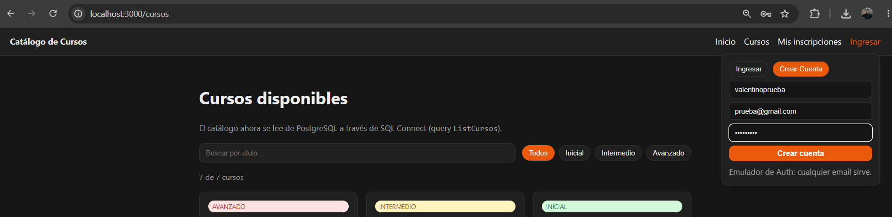
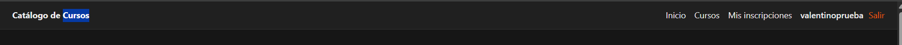
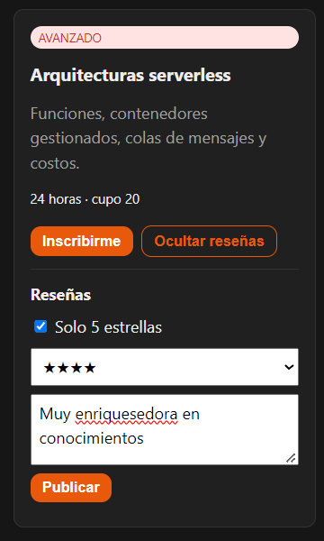
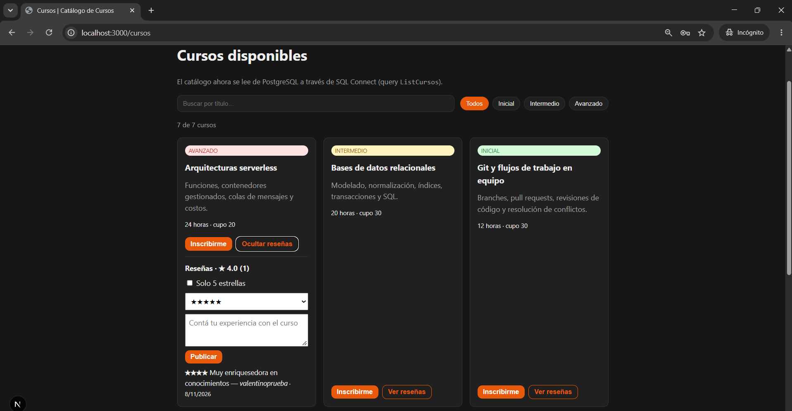

# PRUEBAS ENTREGA 3

## Pruebas funcionales

- **Creo una cuenta para cargar una reseña de un curso e inicio sesión:**

  

  

- **Cargo una reseña desde esta cuenta creada:**

  

- **Ingreso desde incógnito, creo otra cuenta y al ingresar al mismo curso aparece la reseña creada desde la otra cuenta:**

  
